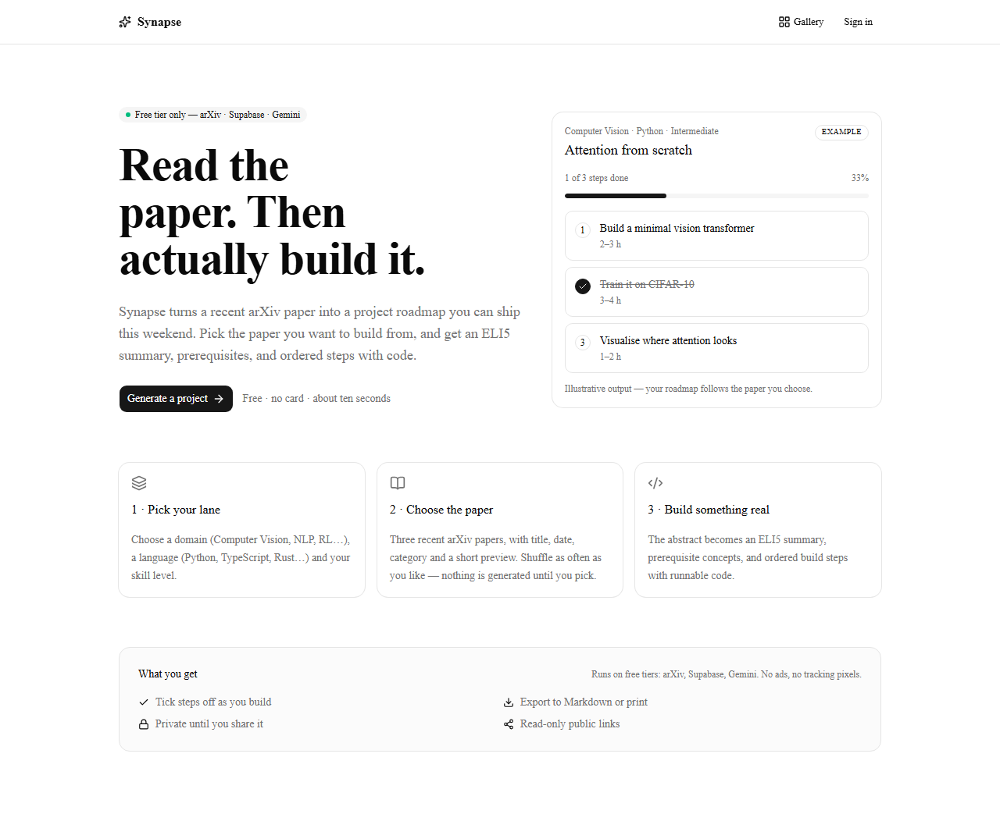
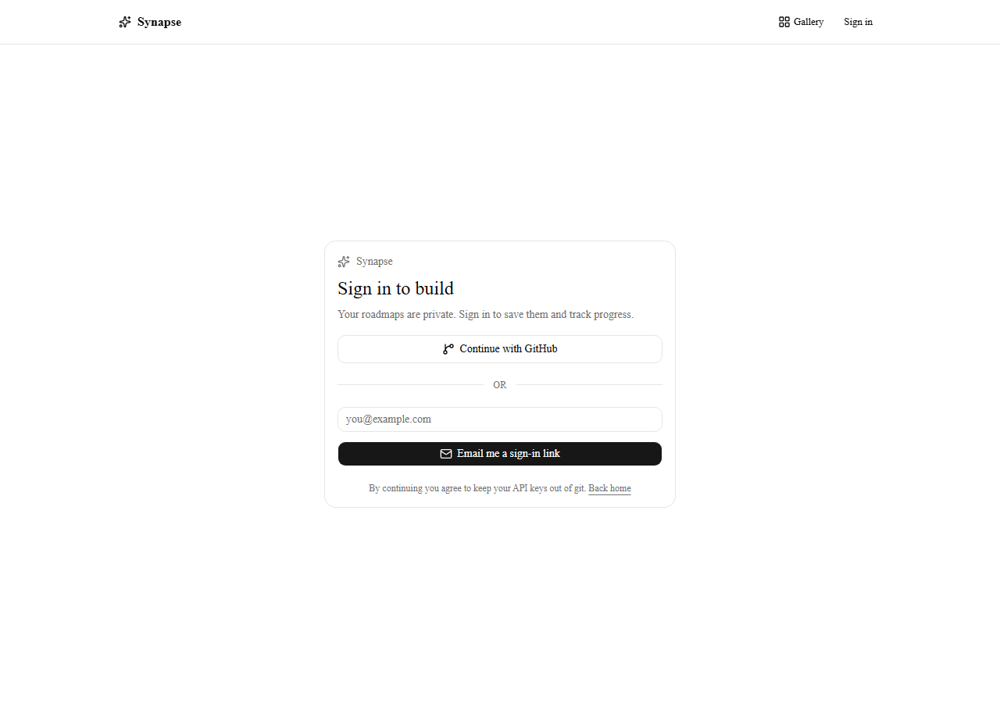
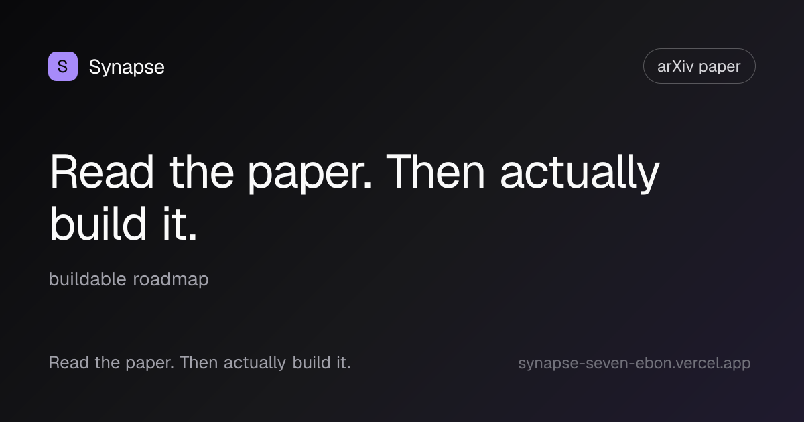

# Synapse

**Read the paper. Then actually build it.**

Synapse bridges academic research and practical engineering. Pick a domain, a
language and a skill level — Synapse finds a recent arXiv paper and turns its
dense abstract into a step-by-step project roadmap you can actually ship.

> Built entirely on free tiers: **arXiv** (papers) · **Supabase** (Postgres, auth,
> RLS) · **Groq / Gemini** (LLM) · **Vercel** (hosting). No paid APIs.

**Live:** <https://synapse-seven-ebon.vercel.app>

## Screenshots

| Landing | Sign in |
|---|---|
|  |  |



<sub>The image above is the fallback link preview served for an unknown slug; a
real share prints the roadmap's own title.</sub>

---

## What it does

1. **Choose** a domain (Computer Vision, NLP, RL…), a language (Python,
   TypeScript, Rust…) and a skill level (Beginner / Intermediate / Advanced).
2. **Pick the paper** — Synapse shows three recent candidates with title,
   category, date and a short preview. Shuffle freely: nothing is generated and
   no quota is spent until you choose. Or let it pick for you.
3. **Generate** — progress streams back as it happens: the paper being read, the
   planning step, the save. The LLM turns the abstract into an ELI5 summary,
   prerequisite concepts, and ordered build steps with code.
4. **Build** — work through the roadmap, ticking steps off as you go. Rename or
   delete any roadmap from the dashboard; deleting one also kills its public
   link. "Try another paper" starts a new roadmap on the same topic.
5. **Share** — publish a read-only link (`/p/<slug>`) that anyone can open
   without an account. Opt-in, revocable, with a generated link preview, and it
   never exposes your profile or your other roadmaps.
6. **Keep it** — download the roadmap as Markdown or print it. Exports from a
   shared link never include the owner's progress.
7. **Browse** — the [public gallery](/gallery) shows roadmaps whose owners opted
   in a second time, filterable by domain. No names, no profiles, and one click
   removes a roadmap from it.

## 60-second demo

1. Open the live URL and press **Generate a project**.
2. Choose **Computer Vision · Python · Beginner** and wait for the three paper
   candidates. Shuffle once — nothing is generated, no quota is spent.
3. Pick one and watch the stages stream: paper lookup → planning → saving.
4. Tick a step, rename the roadmap, then **Share**. Open the link in a private
   window: the roadmap is readable, your progress is not.
5. Back in the workspace, tick **List in the public gallery**, then open
   `/gallery` and filter by your domain. Untick it: the card disappears.
6. Export as Markdown or print. Delete the roadmap from the dashboard — the
   public link now returns the same 404 as one that never existed.

<sub>Funnel events are written as `[event]` lines (`generate_started`,
`generate_done`, `share_created`, `gallery_listed`) and read with
`vercel logs`; page views come from Vercel Web Analytics. Custom Analytics
events are Pro-only, so nothing pretends to send them on the free plan.</sub>

## Stack

| Layer | Choice |
|---|---|
| Framework | Next.js 16 (App Router, React 19, Turbopack) |
| Language | TypeScript (strict) |
| UI | Tailwind CSS v4, shadcn/ui (`base-nova`), lucide-react, sonner |
| Data | arXiv Atom API (`fast-xml-parser`) |
| Database / auth | Supabase (Postgres + RLS, GitHub OAuth + email) |
| AI | Google Gemini free tier (primary) + Groq free tier (automatic fallback) |
| Markdown | react-markdown + rehype-highlight |

## Getting started

**Full walkthrough: [SETUP.md](SETUP.md)** — Supabase project, migration, OAuth,
and a free Groq/Gemini key.

```bash
npm install
cp .env.example .env.local   # then fill in the keys
npm run dev
```

Open <http://localhost:3000>. Without keys the app still boots and shows a setup
card instead of crashing.

### Scripts

| Command | What it does |
|---|---|
| `npm run dev` | Dev server (Turbopack) |
| `npm run build` | Production build + type check |
| `npm run lint` | ESLint |
| `npm run verify:arxiv` | Smoke-test `lib/arxiv.ts` against the live arXiv API |
| `npm run verify:offline` | All offline specs (no keys, no network, no database) |

## Project layout

```
app/
  layout.tsx            root layout, metadata, header slot, toaster
  page.tsx              landing page (RSC)
  login/page.tsx        GitHub OAuth + email magic link (client)
  auth/callback/route.ts  code -> session exchange
  dashboard/page.tsx    generator form + saved roadmaps
  project/[id]/page.tsx project workspace (roadmap / paper / prerequisites)
  gallery/page.tsx      public gallery: opt-in listings, domain filter
  p/[slug]/page.tsx     public read-only share view
  p/[slug]/opengraph-image.tsx  link preview card (1200x630)
  error.tsx, not-found.tsx  error boundary and 404
  api/generate/route.ts arXiv -> LLM -> Postgres, server-only, streams progress
  api/papers/route.ts   candidate search for the picker (reads only)
  actions/              server actions (sign out, toggle a step, sharing)
lib/
  arxiv.ts              typed arXiv Atom client (search + fetch by id)
  papers.ts             candidate ranking, dedupe and previews
  export.ts             roadmap -> Markdown (pure, testable)
  project-ops.ts        rename/delete/share/gallery rules over an injected client
  rate-limit.ts         best-effort fixed-window counter for the API routes
  events.ts             server-side funnel events, one structured log line each
  llm.ts                Groq/Gemini transport, JSON repair retry, provider failover
  roadmap.ts            zod schema for the LLM contract
  env.ts                the only place that reads process.env
  supabase/             browser, server and proxy clients
components/             UI primitives + feature components
supabase/migrations/    SQL schema, RLS policies, signup trigger
scripts/                live smoke checks
```

## Notes on this version

This repo is built on **Next.js 16**, which differs from most tutorials:

- Turbopack is the default for `dev` and `build`.
- `cookies()`, `headers()`, `params`, `searchParams` are **async**.
- `middleware.ts` is now `proxy.ts` (export `proxy`).
- `revalidateTag(tag, profile)` takes two arguments.

Version-matched docs ship inside the package: `node_modules/next/dist/docs/`.

## Roadmap

Phases, acceptance criteria and the full backlog: **[ROADMAP.md](ROADMAP.md)**.

- [x] Next.js + Tailwind + shadcn scaffold
- [x] Typed arXiv client with retry/backoff
- [x] Supabase schema, RLS, GitHub OAuth + email magic link
- [x] `/api/generate` - LLM roadmap with strict JSON validation + repair retry
- [x] Paper picker: three candidates, free shuffle, id-only handoff
- [x] Project workspace with step tracking
- [x] Public share links (read-only, opt-in, revocable) with generated OG cards
- [x] Live generation progress (streamed stages, real paper title)
- [x] Markdown export + print styles
- [x] Error and not-found boundaries
- [x] Rename / delete roadmaps, with the rules tested against a fake client
- [x] Security headers (narrow CSP) and per-user rate limits on both expensive routes
- [x] Public gallery: second opt-in over shared roadmaps, domain filter, instant removal
- [x] Web Analytics page views + server-side funnel events (`[event]` log lines)
- [x] CI: lint, env-less build and eight offline regression specs on every push
- [ ] Streaming roadmaps (progressive JSON steps as the model writes them)

## License

MIT
